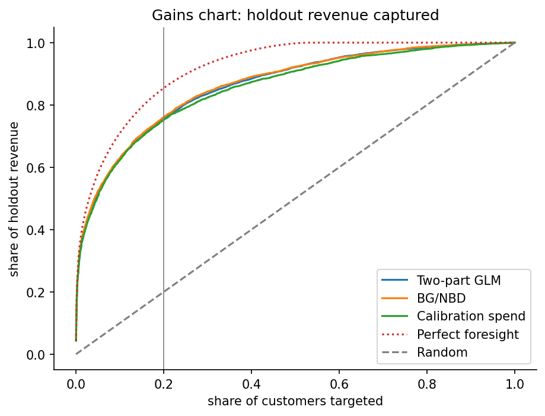
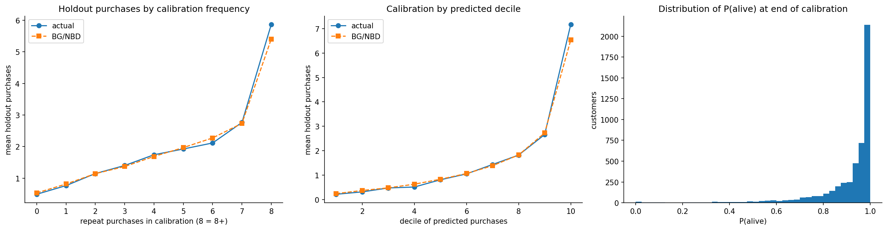
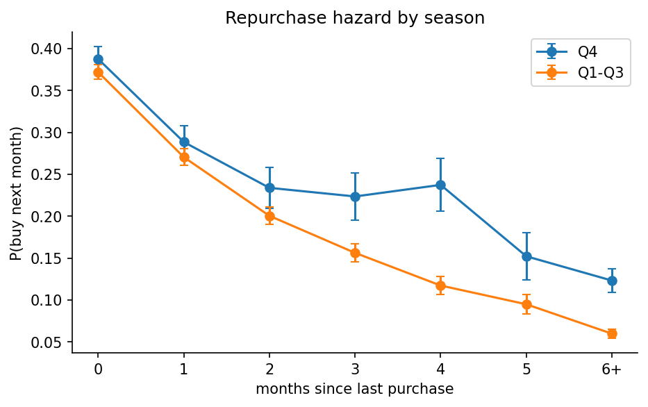

# Who Should Get the Retention Budget? Predicting Customer Value for an Online Retailer

**A backtested customer-value and retention analysis on 1 million+ real transactions:** predicting which customers will come back, what they'll spend, and where a retention team should spend its budget.

> **Headline result:** Ranking customers with a purchase-process model (BG/NBD) that never sees the future, the top 20% of customers captured **76% of next-period revenue**. The model also flagged **37 high-value customers** as at risk; **78% of them never came back**. Together, these customers had spent **£408k** in the previous 18 months.

---

## The product question

A UK online gift retailer (many of its customers are wholesalers) has a retention team with a limited budget. They need answers to five practical questions:

| # | Business question | What I built to answer it |
|---|---|---|
| 1 | What kinds of customers do we have, and do they behave differently next? | Behaviour-based segmentation (PCA + Gaussian mixture), validated with MANOVA |
| 2 | Who is still active, and who is quietly leaving? | BG/NBD purchase model (coded from scratch) + Markov chain over recency |
| 3 | What drives future spend, and do we need a complex model? | Two-part regression (logistic + Gamma GLM) benchmarked against BG/NBD |
| 4 | If we can only review 500 customers, how should we pick them? | Monte Carlo comparison of six sampling designs |
| 5 | Who should get the retention budget? | Gains-chart targeting + an at-risk watch list |

**Evaluation setup.** I treated this as a real forecasting problem: every model is trained on customer behaviour up to **31 May 2011** (calibration) and judged on what customers actually did from **June to December 2011** (holdout), data the models never saw.

---

## Key findings

**1. A small group drives most of the revenue, and we can find them in advance.**
Targeting the top 20% of customers by predicted value (980 customers) would have captured **76% of holdout revenue**, against a ceiling of about 85% with perfect foresight. Two segments make up over 80% of that target list.



**2. Recency and frequency are the signals that matter. Price, returns and country don't.**
Each extra month without a purchase cuts the odds of returning by **~13%**, and the monthly chance of buying again falls from **38%** right after a purchase to **7%** after six quiet months. Once behaviour is accounted for, country explains just **0.3%** of the variation in spend, so there's no need for country-specific spend targets.

**3. A simple, label-free model matched the supervised one.**
BG/NBD predicted total holdout purchases within **2.3%** (7,887 vs 8,071) and separated returning from non-returning customers with **AUC 0.81**. It matched or beat a cross-validated two-part regression on every metric (lower MAE: £574 vs £679), while needing **no training labels**, so it can be deployed on today's data without waiting for an outcome period.



**4. Knowing *when* to act matters as much as *who*.**
Lapsed customers are **twice as likely to come back in Q4** (12% vs 6% monthly for customers inactive 6+ months). Win-back campaigns should run just before the Christmas season, not evenly through the year.



**5. You can measure customer value cheaply, if you sample smartly.**
Because spend is extremely skewed, a simple random sample would need **72% of all customers** to estimate average spend within ±10%. Stratifying by segment with **Neyman allocation** (using past spend to decide where to sample) gives a ±25% estimate from just **500 customers**, with confidence intervals that actually hold up (**92% coverage** vs 79% for random sampling).

---

## Recommendation to the retention team

1. **Focus the main budget on the top 20% by predicted value**, mostly segments S7 and S6. This list covers three-quarters of future revenue.
2. **Run a personal win-back effort for 37 flagged customers.** They were top spenders who have gone unusually quiet; 78% of them did not return on their own. The list is short enough for account managers to call each one.
3. **Time win-back campaigns for early Q4**, when lapsed customers are most receptive.
4. **Treat model forecasts as conservative.** Both models underpredicted the Christmas period by ~2–15%, so budget for upside.

---

## How I approached it

**Data quality first.** The raw data needed real cleaning decisions: 22.8% of lines had no customer ID, the two yearly sheets overlapped by 22,523 duplicate rows, and **6,180 purchase lines (£570k)** were later fully reversed by cancellations. I matched each cancellation to the purchase it reversed rather than just dropping negative rows, so revenue isn't overstated.

**Start simple, then add complexity only where it pays off.** I benchmarked every model against a naive baseline (ranking by past spend), and against each other on business metrics, not just statistical fit:

- **Revenue captured by the top 20%:** the metric the retention team actually cares about
- **AUC and Spearman rank correlation:** can the model order customers correctly?
- **Total predicted vs actual:** is the forecast usable for budgeting?

**Stress-test the assumptions.** Rather than trusting the models, I checked where they break:

- **The Poisson assumption fails for frequent buyers.** 23% buy on a more regular schedule than random (vs 5% expected), mostly wholesalers.
- **Buying isn't stable across the year.** A likelihood-ratio test rejects a single transition matrix ($G^2 = 196$, p < 0.001) because of the Q4 effect.
- **The dropout side of BG/NBD is less certain than it looks.** A parametric bootstrap showed its uncertainty is 50–70% larger than the standard (Hessian) estimates suggest.
- **A gotcha worth knowing:** using a True/False column as a GLM outcome in statsmodels silently models P(False) and flips every coefficient. I caught it with a simulation check.

**Quantify uncertainty honestly.** Bootstrap intervals for segment values, Monte Carlo coverage checks for sampling designs, and robust (HC3) standard errors where the diagnostics called for them.

---

## Methods

| Area | Techniques |
|---|---|
| **Multivariate analysis** | PCA, Gaussian mixture segmentation (BIC), canonical correlation analysis, MANOVA with Box's M and Welch follow-ups |
| **Stochastic models** | BG/NBD coded from the likelihood (MLE, Hessian SEs), Poisson-assumption test via simulation, discrete-time Markov chain, likelihood-ratio homogeneity tests, stationary distribution and first-passage times |
| **Regression** | Logistic and Gamma GLMs (two-part model), OLS diagnostics (Breusch–Pagan, Cook's distance, HC3), Duan's smearing, mixed-effects model with partial pooling |
| **Sampling** | SRS, ratio and regression estimators, stratified sampling with proportional and Neyman allocation, Monte Carlo design comparison |
| **Uncertainty** | Nonparametric and parametric bootstrap, cross-validation |

---

## Limitations and what I'd do next

**Limitations**

- **One model for two kinds of customers.** Wholesale and retail customers are fitted with a single BG/NBD model, even though they buy very differently.
- **No seasonality in the models.** Both purchase models ignore the calendar, which is the main reason they underpredict Christmas.
- **The at-risk list is cautious.** BG/NBD gives every one-time buyer P(alive) = 1, so the list misses some customers who are lapsing.
- **One holdout period.** All results come from a single June–December 2011 window.

**If this were going to production**

- **Segment-specific or covariate-driven BG/NBD,** plus a Gamma–Gamma spend model.
- **A seasonal adjustment** (a quarterly Markov chain or seasonal covariates) for Q4 forecasts.
- **A combined at-risk score,** using P(alive) together with months since last purchase.
- **An A/B test of the win-back campaign,** to measure incremental revenue rather than predicted value.
- **A scheduled monthly refresh** that scores all customers and pushes the target list to the CRM.

---

## Repository structure

```
├── customer_value.ipynb      # Full analysis, with notes under every result
├── data/                     # Place online_retail_II.xlsx here (not committed)
├── figures/                  # All charts, generated by the notebook
└── results/
    ├── summary.json          # Key metrics from every section
    └── customer_scores.csv   # Per-customer scores: segment, P(alive), predicted purchases and spend
```

## How to run

1. Download the dataset from the [UCI Machine Learning Repository](https://archive.ics.uci.edu/dataset/502/online+retail+ii) and save it as `data/online_retail_II.xlsx`.
2. Install the dependencies (Python 3.10+):
   ```bash
   pip install numpy pandas scipy scikit-learn statsmodels matplotlib seaborn openpyxl jinja2 jupyter
   ```
3. Open `customer_value.ipynb` and run all cells. Settings such as the calibration cutoff, sample size and number of bootstrap replicates are at the top of the notebook.

## Data

Daqing Chen, *Online Retail II*, UCI Machine Learning Repository (2012), licensed under [CC BY 4.0](https://creativecommons.org/licenses/by/4.0/). Transactions from a UK-based online gift retailer, December 2009 to December 2011.

